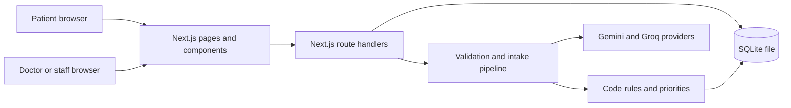
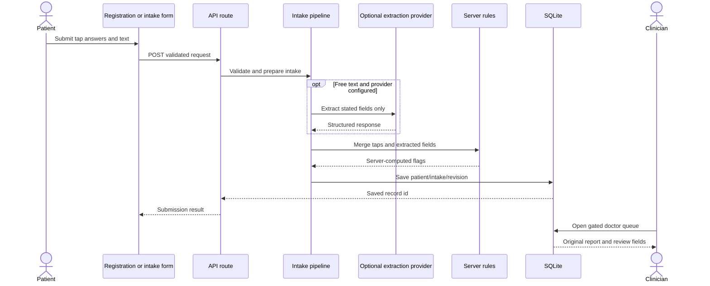
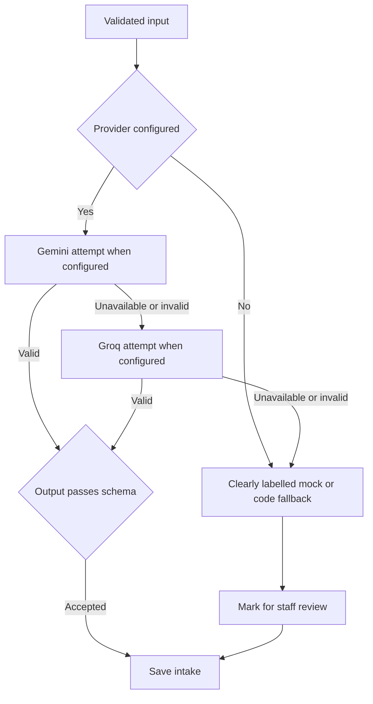

# Architecture and workflows

These diagrams describe the current code in the App Router, not a proposed production deployment. The app uses server-side Next.js routes and a local better-sqlite3 database. See lib/db.ts, lib/schema.sql, app/api/intake/route.ts, app/api/register/route.ts, lib/submitIntake.ts, and lib/llm.ts.

## System architecture

## Patient submission to doctor review

## ER diagram

This ER diagram shows the principal relationships in lib/schema.sql and the create-table migrations in lib/db.ts. It is a readable subset of the full database; data-model.md lists the remaining tables too.

```mermaid
erDiagram
  patients ||--o{ intakes : submits
  intakes ||--o{ intake_revisions : snapshots
  patients ||--o{ notes : has
  intakes ||--o{ notes : documents
  patients ||--o{ followups : has
  intakes ||--o{ followups : references
  patients ||--o{ case_summaries : summarized
  intakes ||--o{ case_summaries : derived_from
  anonymous_sessions ||--o{ consent_records : records
  anonymous_sessions ||--o{ survey_responses : answers
  anonymous_sessions ||--o| risk_assessments : assessed
  scoring_versions ||--o{ risk_assessments : scores
  risk_assessments ||--o{ recommendations : recommends
  anonymous_sessions ||--o{ safety_escalations : escalates
  redflag_rulesets ||--o{ safety_escalations : governs
  anonymous_sessions ||--o{ bookings : creates
  test_locations ||--o{ bookings : selected
  anonymous_sessions ||--o{ contact_details : shares
  consent_records ||--o{ contact_details : authorizes
  anonymous_sessions ||--o{ lab_results : enters
  scoring_versions ||--o{ lab_results : categorizes
  lab_results ||--o| clinical_reviews : reviewed
  patients {
    int id PK
    string name
    int age
    string diabetes_type
  }
  intakes {
    int id PK
    int patient_id FK
    string input_method
    string raw_text
    string status
    string priority
    int version
  }
  intake_revisions {
    int id PK
    int intake_id FK
    int revision
    string source
    string snapshot_json
  }
  notes {
    int id PK
    int patient_id FK
    string note_text
    string light
  }
  followups {
    int id PK
    int patient_id FK
    int intake_id FK
    string plan_json
  }
  case_summaries {
    int id PK
    int patient_id FK
    int intake_id FK
    string generation_mode
    string summary_text
  }
  anonymous_sessions {
    string id PK
    string status
    string locale
    string scoring_version_id
    string redflag_ruleset_id
  }
  consent_records {
    string id PK
    string session_id FK
    string purpose
    int granted
  }
  survey_responses {
    string id PK
    string session_id FK
    string question_id
    string option_id
    int points
  }
  scoring_versions {
    string id PK
    string status
    string config_hash
  }
  risk_assessments {
    string id PK
    string session_id FK
    string scoring_version_id FK
    int total_points
    string band
  }
  recommendations {
    string id PK
    string assessment_id FK
    string kind
  }
  safety_escalations {
    string id PK
    string session_id FK
    string ruleset_id
    string source
  }
  redflag_rulesets {
    string id PK
    string version_label
    string status
  }
  test_locations {
    string id PK
    string name
    int is_demo_data
  }
  bookings {
    string id PK
    string session_id FK
    string location_id FK
    string status
  }
  contact_details {
    string id PK
    string session_id FK
    string consent_id FK
  }
  lab_results {
    string id PK
    string session_id FK
    string categorization_version_id FK
    int verified
  }
  clinical_reviews {
    string id PK
    string lab_result_id FK
    string status
    string outcome
  }
```

## LLM provider fallback

This flow applies to structured intake extraction and other components with a provider sequence. Components differ: case summary uses Groq only, while screening uses no LLM.

